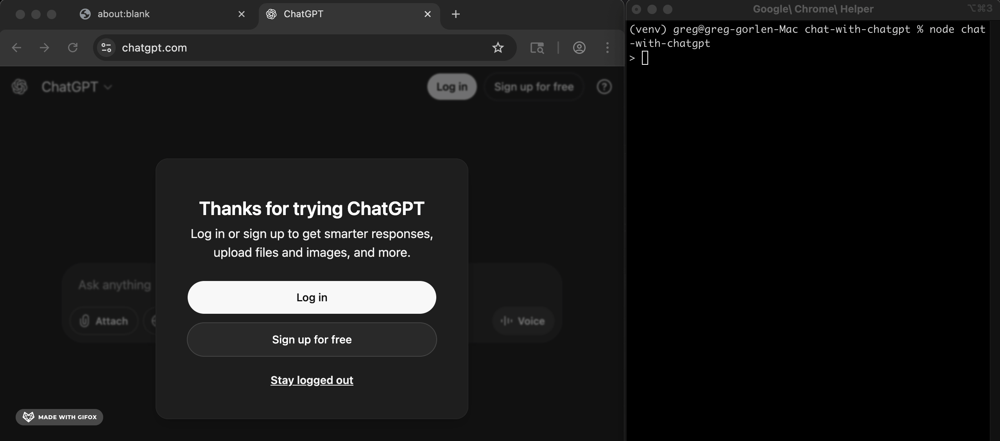

# chat-with-chatgpt

A toy automation experiment: is it possible to automate ChatGPT with Puppeteer?

```
npm i
node chat-with-chatgpt
```



- Might be worth trying to reverse engineer:
  - https://stackoverflow.com/ai-assist
  - https://www.perplexity.ai/
  - https://gemini.google.com/app
  - https://minitoolai.com/grok/
  - etc
